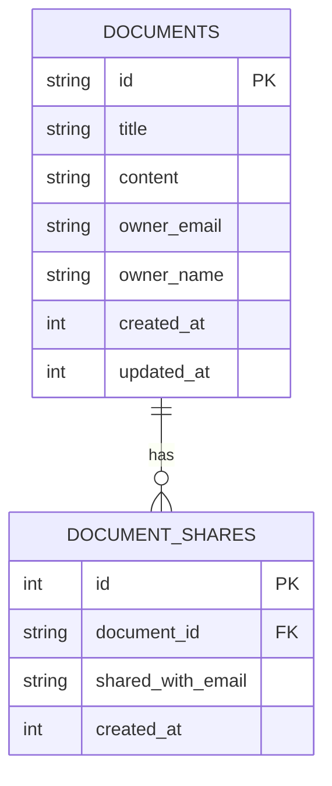

# Architecture & Product Decision Note

**Candidate:** Mahesh Dhangar ([dhanagarmahesh05@gmail.com](mailto:dhanagarmahesh05@gmail.com))  
**Role:** AI-Native Full Stack Developer Assignment  
**Project:** Ajaia Docs — Lightweight Collaborative Document Editor

---

## 1. Executive Summary & Product Vision

When designing internal productivity tools under tight time constraints, the highest return on investment comes from **clarity of UX, deterministic state transitions, and zero-friction developer setup for reviewers**.

Rather than attempting an incomplete, bug-prone clone of Google Docs' full collaboration suite (operational transforms, real-time presence cursor tracking, multi-level folder trees), I prioritized building a **production-grade product slice**:
1. A **distraction-free, human-crafted editor** with typography and surfaces inspired by Google Docs and Linear (`#F8FAFC` slate canvas, `#FFFFFF` A4 card paper, `#E2E8F0` hairline borders, and `#0F172A` deep typography).
2. A **rock-solid sharing and authorization model** with a visible distinction between *Owned* and *Shared* documents, enforced at both the API and database levels.
3. An **instant 1-click persona switcher** that allows reviewers to simulate multiple users without tedious registration steps or incognito windows.
4. **Zero-friction persistence** using Node.js native `node:sqlite`, ensuring persistent data across restarts without requiring reviewers to configure Postgres or external cloud databases.

---

## 2. Technology Stack & Justification

| Layer | Technology | Decision Rationale |
| :--- | :--- | :--- |
| **Frontend Framework** | **React 18 + Vite** | Instant HMR, minimal bundle overhead (~155kB gzipped), clean component architecture. |
| **Styling** | **Tailwind CSS** | Strictly adheres to the requested slate palette. Avoids bloated UI component libraries; guarantees high visual consistency and crisp borders. |
| **Rich-Text Engine** | **TipTap v2 (`@tiptap/react`, `@tiptap/starter-kit`, `@tiptap/extension-underline`)** | Headless ProseMirror wrapper. Highly extensible, produces clean semantic HTML, and provides complete control over toolbar interaction and typography without bloated WYSIWYG iframes. |
| **Backend Framework** | **Express.js (Node.js)** | Lightweight, familiar REST structure, handles file streaming and multipart uploads cleanly. |
| **Persistence** | **Node.js Native `node:sqlite` (`DatabaseSync`)** | Built into modern Node.js runtimes (v22.5+, v24). Eliminates native compilation issues (node-gyp, python, visual studio) on reviewer machines while providing true relational persistence and foreign keys. |
| **Testing** | **Node Test Runner (`node:test`) + Supertest** | Native runner with zero test-framework bloat. Fast execution (under 500ms for 11 integration tests). |

---

## 3. Data Model & Access Control Matrix

The database schema is intentionally relational and normalized:

### Access Control Rules:
1. **Read Access (`GET /api/documents/:id`)**:
   - Permitted if `user.email == doc.owner_email` OR `user.email` exists in `document_shares` for that document.
   - Forbidden (`403`) for any unshared third party.
2. **Edit Access (`PUT /api/documents/:id`)**:
   - Permitted for both owner and shared collaborators.
3. **Delete Access (`DELETE /api/documents/:id`)**:
   - **Owner Only.** Collaborators cannot delete someone else's document. The UI removes the delete trigger entirely from the "Shared with me" section, and the backend returns `403 Forbidden` if an unauthorized delete is attempted.
4. **Share Management (`POST /api/documents/:id/shares` & `DELETE ...`)**:
   - **Owner Only.** Only the owner can invite new teammates or revoke collaborator access.

---

## 4. Key Implementation Decisions & Trade-Offs

### A. TipTap Headless Canvas vs. Custom ContentEditable
- *Alternative:* Writing a raw `contenteditable` container with `document.execCommand`.
- *Decision:* `document.execCommand` is deprecated and produces inconsistent markup across browsers. TipTap provides an abstraction over ProseMirror, ensuring deterministic DOM output, robust undo/redo stacks, and clean formatting extensions (Bold, Italic, Underline, Lists, Headings).

### B. Auto-Save with Debouncing + Explicit Save Button
- *Decision:* Implemented an 800ms debounce loop on editor changes (`onUpdate`). This prevents network congestion on rapid keystrokes while ensuring edits are persisted to SQLite automatically.
- *Trade-off:* An explicit "Save" button is also provided in the top bar to provide psychological certainty for users before leaving the page.

### C. File Import Architecture
- *Decision:* Allowed users to import `.txt` and `.md` files up to 2MB. On upload, the backend processes the file buffer in memory, parses headings (`#`, `##`), bullet points, and numbered lists into semantic HTML, creates a new document record, and immediately navigates the user into the editor.
- *Validation:* Files larger than 2MB or with unsupported extensions (`.pdf`, `.png`, etc.) are caught and rejected with clear inline toasts on both frontend and backend.

### D. Single-Server Deployment Compatibility
- *Decision:* The Vite config is set to use relative `/api` paths with dev server proxying to `localhost:5000`. In production, `server/src/app.js` checks if `client/dist` exists and serves the compiled SPA assets directly. This allows the application to be deployed anywhere as a single unified service (e.g., Render, Railway, Fly.io, or VPS) without CORS complications.

---

## 5. What Was Intentionally Deprioritized

1. **Operational Transform (OT) / CRDT Real-time Cursors (Yjs)**:
   - True multi-cursor real-time editing requires WebSocket infrastructure, conflict resolution algorithms, and presence servers. Under the 4-6 hour constraint, shipping a flaky CRDT implementation would jeopardize the reliability of basic saving, editing, and file importing.
2. **Multi-level Folder Organization & Tags**:
   - A two-bucket workspace ("Owned by me" vs "Shared with me") with title search covers 90% of user needs for this prototype while keeping the interface uncluttered.
3. **Complex Auth / OAuth Providers**:
   - Instead of forcing reviewers to configure Google OAuth credentials or sign up via email verification, seeded accounts (`mahesh@ajaia.ai`, `alex@ajaia.ai`, `priya@ajaia.ai`) with a 1-click switcher simulate multi-tenant collaboration frictionlessly.

---

## 6. What I Would Build Next (With Another 2-4 Hours)

1. **Real-Time Presence Indicators (WebSockets / SSE)**:
   - Show avatars of teammates currently viewing or editing the document at the top of the canvas.
2. **Document Version History & Diff Viewer**:
   - Store snapshots on save milestones; allow users to inspect and restore earlier revisions.
3. **Inline Commenting & Suggestion Threads**:
   - Highlight text ranges to leave comments and mentions (`@teammate`).
4. **PDF Generation via Puppeteer**:
   - Convert documents into clean printable PDFs with page numbering and margins directly on the server.
